# Space Invaders 👾🚀

<div align="center">

  <!-- Cinematic Animated Hero Banner -->
  

  <br><br>

  <!-- Arcade Action Buttons -->
  <p align="center">
    <a href="https://theneerajgrover.github.io/space-invaders-java/">
      
    </a>
    &nbsp;
    <a href="#quick-start--setup">
      
    </a>
    &nbsp;
    <a href="https://github.com/theneerajgrover/space-invaders-java">
      
    </a>
    &nbsp;
    <a href="#game-controls">
      
    </a>
    &nbsp;
    <a href="#system-architecture">
      
    </a>
    &nbsp;
    <a href="#rest-api-endpoints">
      
    </a>
  </p>

  <!-- Verified Technology Stack Badges -->
  <p align="center">
    
    &nbsp;
    
    &nbsp;
    
    &nbsp;
    
    <br>
    
    &nbsp;
    
    &nbsp;
    
    &nbsp;
    
  </p>

  <p align="center">
    <strong>Defend Earth from the incoming extraterrestrial formation in an authentic, high-octane indie-arcade browser shooter.</strong><br>
    Engineered with zero frontend runtime dependencies, smooth 60 FPS HTML5 Canvas rendering, and an enterprise Java Spring Boot 3 REST tier backed by embedded SQLite persistence.
  </p>

</div>

---

## 📋 Table of Contents

- [🌌 Project Overview](#-project-overview)
- [👾 Visual Mechanics & Animated Units](#-visual-mechanics--animated-units)
- [📸 In-Game Visual Gallery](#-in-game-visual-gallery)
- [✨ Core Gameplay Features](#-core-gameplay-features)
- [🎮 Game Controls & Objectives](#-game-controls--objectives)
- [🛠️ Technology Stack](#️-technology-stack)
- [🏛️ System Architecture](#️-system-architecture)
- [🔄 Gameplay Lifecycle & State Flow](#-gameplay-lifecycle--state-flow)
- [🌐 REST API Endpoints](#-rest-api-endpoints)
- [💾 Database & Persistence Architecture](#-database--persistence-architecture)
- [🎓 Technical Viva & Architectural Deep Dive](#-technical-viva--architectural-deep-dive)
- [📁 Project Structure](#-project-structure)
- [🚀 Quick Start & Setup](#-quick-start--setup)
- [🧪 Automated Testing Suite](#-automated-testing-suite)
- [🚢 Deployment Considerations](#-deployment-considerations)
- [⚠️ Known Limitations](#️-known-limitations)
- [📦 Repository Information](#-repository-information)

---

<a id="project-overview"></a>
## 🌌 Project Overview

**Space Invaders** reimagines the legendary 1978 arcade phenomenon through a sleek, neon-drenched retro-futuristic aesthetic. An armada of 32 extraterrestrial invaders marches relentlessly toward Earth's defense perimeter. Piloting a ground-based laser defense cannon, you must neutralize the hostile vanguard before their atmospheric drop breaches planetary airspace or their retaliatory plasma bolts deplete your shielding.

### Architectural Philosophy: Clean Decoupling
This project was constructed as a robust college-level demonstration of **Full-Stack Separation of Concerns**:
1. **Client Tier (Browser):** Real-time 60 FPS graphics, input response, and physics run entirely client-side on an HTML5 `<canvas>` via pure Vanilla JavaScript. No heavy frontend frameworks (React, Angular, Vue) or UI libraries bloat the rendering pipeline.
2. **Server Tier (Java Spring Boot 3):** A layered RESTful service layer handling score reception, bean validation, and data transformation.
3. **Storage Tier (SQLite 3):** An embedded relational database providing persistent disk-backed storage across restarts without demanding external server daemon configurations (e.g., MySQL or PostgreSQL).

---

<a id="visual-mechanics"></a>
## 👾 Visual Mechanics & Animated Units

The game's visual design leverages pure vector geometry, dynamic CSS keyframes, and HTML5 Canvas drawing routines. Below are the core units featured in the continuous defense loop:

<div align="center">
  <table>
    <tr>
      <th width="50%" align="center">👾 Alien Vanguard (Squad Unit)</th>
      <th width="50%" align="center">🚀 Earth Defense Cannon (Player)</th>
    </tr>
    <tr>
      <td align="center">
        
        <br>
        <em>Continuous two-frame marching shuffle with neon glow</em>
      </td>
      <td align="center">
        
        <br>
        <em>Hovering vector defense craft with active plasma thrusters</em>
      </td>
    </tr>
    <tr>
      <td>
        • <strong>Formation Size:</strong> 4 rows × 8 columns = 32 invaders.<br>
        • <strong>Color Hierarchy:</strong> Top rows violet (<code>#b388ff</code>), bottom rows coral/red (<code>#ff6b6b</code>).<br>
        • <strong>Marching AI:</strong> Steps horizontally across the canvas; on boundary contact, reverses direction and drops <strong>22 px</strong> closer.<br>
        • <strong>Retaliation:</strong> Each alive unit has a random per-frame probability (<code>0.002</code>) to discharge downward plasma bolts.
      </td>
      <td>
        • <strong>Chassis:</strong> Sleek 48×32 px cyan vector triangle (<code>#00e5ff</code>) with cockpit canopy and wing accents.<br>
        • <strong>Propulsion:</strong> Glowing green plasma thrusters (<code>#39ff14</code>).<br>
        • <strong>Ordnance:</strong> Rapid-fire laser cannon firing upward at 8 px/frame with a <strong>250 ms</strong> rate-limiting cooldown to prevent spam.<br>
        • <strong>Movement Boundary:</strong> Clamped strictly within the 800 px canvas width.
      </td>
    </tr>
  </table>
</div>

---

<a id="game-gallery"></a>
## 📸 In-Game Visual Gallery

Captured directly from the live application without artificial mockups or synthetic UI alterations:

<div align="center">
  <table>
    <tr>
      <td width="50%" align="center">
        <strong>1. Main Menu (Two-Column Layout)</strong><br><br>
        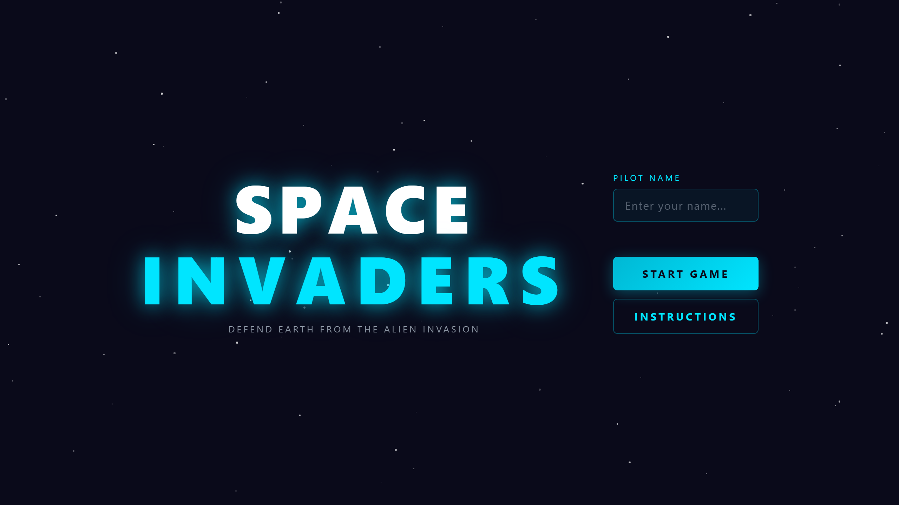
      </td>
      <td width="50%" align="center">
        <strong>2. How to Play (Instructions Screen)</strong><br><br>
        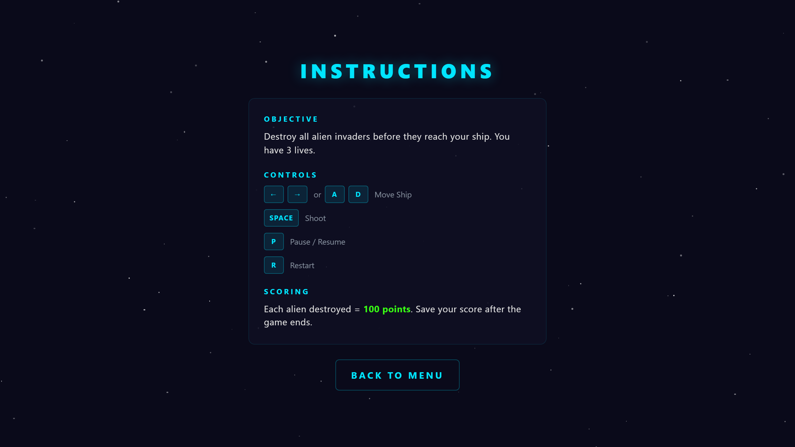
      </td>
    </tr>
    <tr>
      <td width="50%" align="center">
        <strong>3. Active 60 FPS Gameplay (HUD Active)</strong><br><br>
        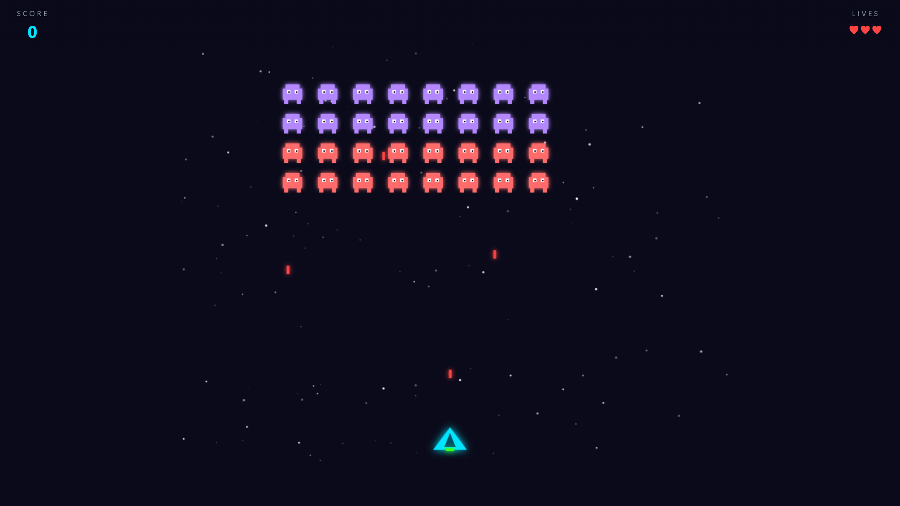
      </td>
      <td width="50%" align="center">
        <strong>4. Game Over Screen (Defeat Flow)</strong><br><br>
        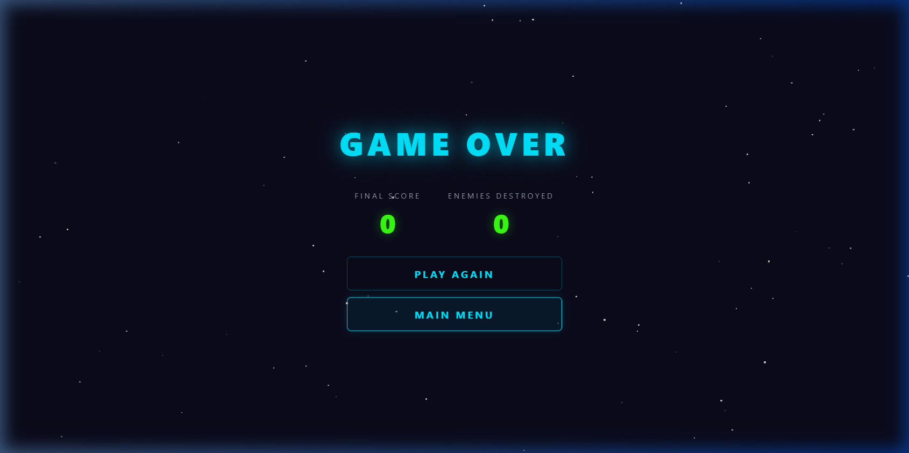
      </td>
    </tr>
  </table>
</div>

> [!NOTE]
> **Victory Screen & Persistence Note:**  
> When a pilot destroys all 32 invaders, the game triggers `endGame(true)` and activates the **Victory Screen**. This screen presents final combat statistics alongside the primary **`SAVE SCORE`** action button, which dispatches a `POST /api/scores` request to the Spring Boot backend. In accordance with commit [`e80e659`](https://github.com/theneerajgrover/space-invaders-java/commit/e80e659), the **Game Over** screen no longer contains a save button, preserving database records exclusively for accomplished mission completions.

---

<a id="core-features"></a>
## ✨ Core Gameplay Features

- **High-Performance 60 FPS Canvas Engine:** Driven by `window.requestAnimationFrame()` with explicit cancellation on reset to guarantee zero duplicate game loops or frame acceleration bugs.
- **Axis-Aligned Bounding Box (AABB) Collision System:** Millisecond-accurate mathematical boundary checks between lasers, player hull, and invader units.
- **Dynamic Alien Marching AI:** The 32-alien swarm synchronizes movement, accelerating its descent each time the edge of the cosmos is encountered.
- **Pilot Registration & Input Sanitization:** Client-side validation enforces non-empty names up to 20 characters, with server-side trimming prior to persistence.
- **Real-Time Heads-Up Display (HUD):** Instantaneous score updates and visual heart-based life counter (`♥♥♥`).
- **Tactical Pause & Instant Restart:** Press `P` at any instant to pause execution; press `R` to instantly re-seed the starfield and enemy formation.
- **Dual-Mode Persistence Pipeline:**
  - **Local Spring Boot Server:** Directly executes `POST /api/scores` to write records into SQLite (`data/space_invaders.db`).
  - **Static GitHub Pages Deployment:** Automatically detects GitHub Pages hosting (`hostname.endsWith('github.io')`) and falls back to browser `localStorage` so web visitors can still test saving scores.

---

<a id="game-controls"></a>
## 🎮 Game Controls & Objectives

### Input Mapping

| Key | Alternate Key | In-Game Action | Operational Details |
|:---:|:---:|---|---|
| <kbd>←</kbd> | <kbd>A</kbd> | **Move Ship Left** | Moves craft left at 6 px/frame; clamped at $X = 0$. |
| <kbd>→</kbd> | <kbd>D</kbd> | **Move Ship Right** | Moves craft right at 6 px/frame; clamped at $X = 752$. |
| <kbd>Spacebar</kbd> | — | **Fire Laser Cannon** | Discharges green laser bolt; enforces 250 ms cooldown. |
| <kbd>P</kbd> | — | **Pause / Resume** | Freezes game loop and reveals pause overlay. |
| <kbd>R</kbd> | — | **Restart Game** | Immediately aborts active frame and initializes new match. |
| <kbd>Enter</kbd> | — | **Start Match** | Submits pilot name directly from input field. |
| <kbd>Escape</kbd> | — | **Back to Menu** | Dismisses instructions view and returns to title screen. |

### Mission Rules & Victory Conditions
- **Score Value:** **100 Points** awarded per eliminated alien invader (Maximum capped at $999,999$).
- **Lives:** Player begins with **3 lives** (`♥♥♥`). Each enemy laser impact reduces lives by 1.
- **Defeat Condition:** Depleting all 3 lives **OR** allowing any alien to descend to the player's Y-altitude triggers **Game Over**.
- **Victory Condition:** Eradicating all 32 invaders triggers **Victory**, allowing the pilot to commit their score to the database.

---

<a id="technology-stack"></a>
## 🛠️ Technology Stack

Verified directly against `pom.xml`, source code, and deployment workflows:

| Tier | Component | Version / Specification | Technical Role in Project |
|---|---|:---:|---|
| **Frontend** | HTML5 Canvas | Standard | High-frequency 60 FPS 2D rendering surface ($800 \times 600$ px). |
| **Frontend** | Vanilla JavaScript | ES6+ | State machine, keyboard listeners, AABB collisions, starfield particles. |
| **Frontend** | CSS3 | Standard | Neon arcade styling, CSS star twinkle keyframes, flexbox two-column menu. |
| **Backend** | Java | **17 LTS** | Target language platform (`<java.version>17</java.version>`). |
| **Backend** | Spring Boot | **3.2.5** | Core framework (`spring-boot-starter-web`, Spring MVC REST controllers). |
| **Backend** | Spring Data JPA | 3.2.5 | Hibernate ORM repository abstraction and JPQL query execution. |
| **Backend** | Jakarta Validation | Standard | `@NotBlank`, `@Size`, `@Min`, `@Max` bean constraint validation. |
| **Database** | SQLite 3 | **3.45.3.0** | Embedded serverless file database via `org.xerial:sqlite-jdbc`. |
| **Database** | Hibernate Community | Standard | `org.hibernate.community.dialect.SQLiteDialect` for schema integration. |
| **Build** | Apache Maven | 3.6+ / Wrapper | Self-contained build lifecycle management (`mvnw`, `mvnw.cmd`). |
| **CI / CD** | GitHub Actions | v4 | Automated workflow deploying static frontend assets to GitHub Pages. |

---

<a id="system-architecture"></a>
## 🏛️ System Architecture

<div align="center">
  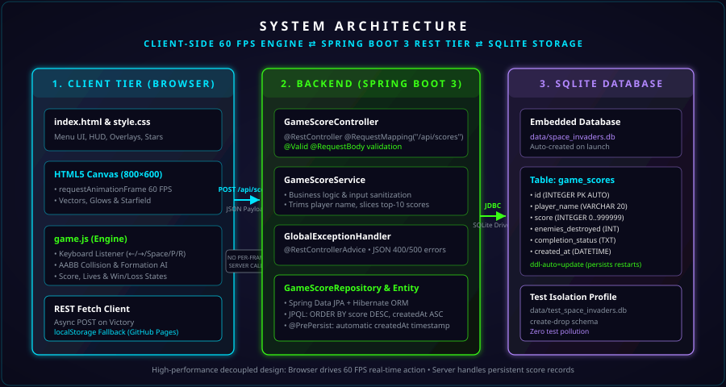
</div>

### Architectural Decoupling: Real-Time vs. Persistence
A crucial architectural decision in this project is the **complete decoupling** between the high-frequency game rendering loop and the backend network tier:
- **No Per-Frame Network Overhead:** The browser manages frame timing, math calculations, sprite positioning, starfield scrolling, and collision checks at 60 FPS without ever blocking on HTTP requests.
- **Event-Driven API Interaction:** The backend is contacted **strictly on terminal game events** (specifically when the player achieves Victory and initiates a score save).

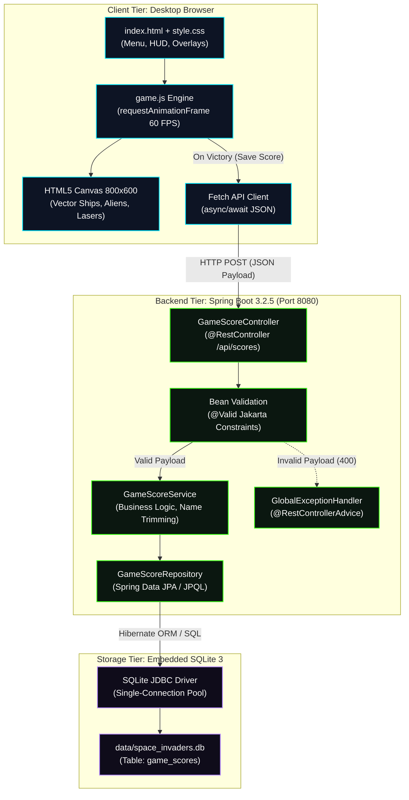

---

<a id="gameplay-lifecycle"></a>
## 🔄 Gameplay Lifecycle & State Flow

<div align="center">
  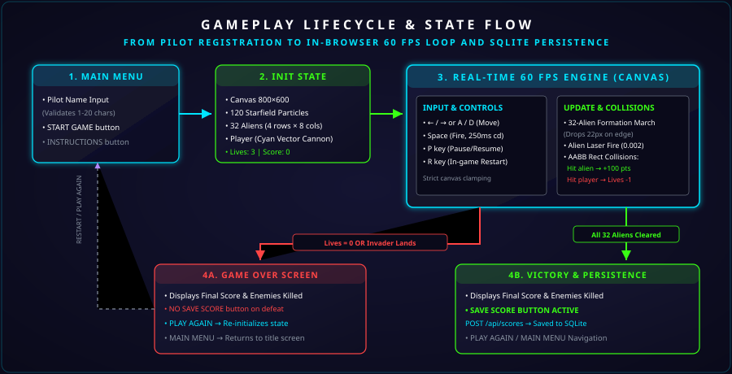
</div>

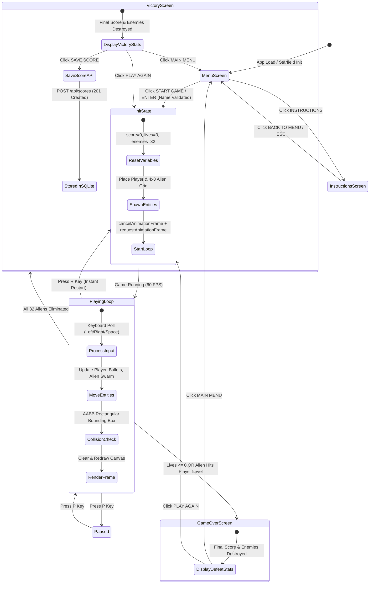

---

<a id="rest-api-endpoints"></a>
## 🌐 REST API Endpoints

All backend endpoints are exposed under base route `/api/scores`:

| HTTP Method | Path | Summary & Purpose | Request Body | Success Response | Error Response |
|:---:|---|---|:---:|:---:|:---:|
| `POST` | `/api/scores` | Persists a newly completed game score | JSON `GameScore` | `201 Created`<br>(Echoes saved entity with DB ID) | `400 Bad Request`<br>(Validation breakdown) |
| `GET` | `/api/scores/leaderboard` | Retrieves top 10 historical scores | *None* | `200 OK`<br>(JSON Array of up to 10 entities) | `500 Internal Error` |
| `GET` | `/api/scores/player/{playerName}` | Retrieves score history for specific pilot | *None* | `200 OK`<br>(JSON Array sorted by score DESC) | `400 Bad Request`<br>(Blank name) |

### Sample Score Submission Payload (`POST /api/scores`)
```json
{
  "playerName": "AcePilot",
  "score": 3200,
  "enemiesDestroyed": 32,
  "completionStatus": "WON"
}
```

### Sample Validation & Entity Constraints
- `playerName`: Mandatory (`@NotBlank`), maximum 20 characters (`@Size(max = 20)`). Automatically trimmed of leading and trailing whitespace by `GameScoreService`.
- `score`: Mandatory (`@NotNull`), non-negative integer from $0$ to $999,999$ (`@Min(0)`, `@Max(999999)`).
- `enemiesDestroyed`: Optional non-negative integer from $0$ to $1,000$ (`@Min(0)`, `@Max(1000)`).
- `completionStatus`: String token indicating outcome (`"WON"` or `"LOST"`), maximum 10 characters (`@Size(max = 10)`).
- `createdAt`: Timestamp automatically injected by Hibernate via JPA lifecycle event (`@PrePersist`).

---

<a id="database-persistence"></a>
## 💾 Database & Persistence Architecture

- **Database Engine:** Embedded SQLite 3 file-backed database.
- **Production File Location:** `data/space_invaders.db` (auto-generated in the working root on application startup).
- **Driver & Dialect:** `org.xerial:sqlite-jdbc:3.45.3.0` paired with `org.hibernate.community.dialect.SQLiteDialect`.
- **Schema Evolution:** Managed with `spring.jpa.hibernate.ddl-auto=update`, ensuring existing records survive across server reboots.
- **HikariCP Connection Pool:** SQLite is a file-based embedded engine that performs optimally with a single connection. The configuration explicitly provisions:
  ```properties
  spring.datasource.hikari.maximum-pool-size=1
  spring.datasource.hikari.minimum-idle=1
  ```
- **Test Isolation:** Automated unit and integration tests run under Spring's `test` profile (`src/test/resources/application-test.properties`), targeting an isolated database (`data/test_space_invaders.db`) with `create-drop` semantics, guaranteeing production data is never touched or polluted during automated test passes.

---

<a id="technical-viva"></a>
## 🎓 Technical Viva & Architectural Deep Dive

For academic examinations, viva defenses, and technical project presentations:

<details>
<summary><strong>1. Why use HTML5 Canvas & Vanilla JS instead of React or Vue?</strong></summary>

<br>
React's virtual DOM reconciliation cycle introduces unnecessary CPU overhead and garbage collection pauses when running high-frequency 60 FPS animation loops. HTML5 Canvas provides direct, immediate-mode hardware-accelerated 2D rendering. Using Vanilla JavaScript eliminates external dependencies, minimizes package footprint, and ensures 100% deterministic frame timing through <code>requestAnimationFrame</code>.
</details>

<details>
<summary><strong>2. How does the backend prevent database corruption in SQLite?</strong></summary>

<br>
SQLite does not run as a multi-threaded daemon. When multiple threads attempt concurrent writes, SQLite file locks can trigger database locking errors. The Spring Boot backend prevents this by configuring HikariCP's maximum pool size to <code>1</code> (<code>spring.datasource.hikari.maximum-pool-size=1</code>), serializing write operations cleanly through a single controlled connection.
</details>

<details>
<summary><strong>3. How are duplicate animation loops prevented during in-game restarts?</strong></summary>

<br>
In <code>game.js</code>, every animation request records its ID into <code>animFrameId</code>. Whenever a game restart occurs (via the <code>R</code> key or <code>initGame()</code>), the engine explicitly calls <code>cancelAnimationFrame(animFrameId)</code> prior to invoking a new loop. This prevents the common JavaScript bug where multiple overlapping loops accelerate game speed exponentially.
</details>

<details>
<summary><strong>4. How does the JPA Repository ensure fair leaderboard rankings?</strong></summary>

<br>
In <code>GameScoreRepository.java</code>, leaderboard ordering utilizes a custom JPQL query:
<pre><code>SELECT g FROM GameScore g ORDER BY g.score DESC, g.createdAt ASC, g.id ASC</code></pre>
This ensures fair tie-breaking: when two pilots achieve the same numerical score, the pilot who achieved the score earlier in time (earlier <code>createdAt</code>) ranks higher.
</details>

<details>
<summary><strong>5. How does GlobalExceptionHandler protect internal backend details?</strong></summary>

<br>
Annotated with <code>@RestControllerAdvice</code>, <code>GlobalExceptionHandler.java</code> intercepts validation exceptions (<code>MethodArgumentNotValidException</code>) to emit clean, actionable JSON field error messages. Unexpected server exceptions are caught and sanitized into safe <code>500 Internal Server Error</code> responses, preventing stack traces, internal paths, or SQL queries from leaking to client browsers.
</details>

---

<a id="project-structure"></a>
## 📁 Project Structure

```
space-invaders-java/
├── .github/
│   └── workflows/
│       └── deploy-pages.yml          # GitHub Pages CI/CD workflow
├── docs/
│   └── readme-assets/                # Committed README assets & illustrations
│       ├── architecture-diagram.svg  # System architecture vector diagram
│       ├── gameplay-lifecycle.svg    # State machine flowchart diagram
│       ├── hero-banner.svg           # Animated cinematic hero banner
│       ├── invader-animated.svg      # Looping pixel invader animation
│       ├── player-ship-animated.svg  # Looping player cannon animation
│       ├── footer-banner.svg         # Animated footer emblem
│       ├── main-menu.png             # Authentic Main Menu screenshot
│       ├── instructions.png          # Authentic Instructions screenshot
│       ├── gameplay.png              # Authentic Active Gameplay screenshot
│       ├── game-over.png             # Authentic Game Over screenshot
│       └── btn-*.svg / badge-*.svg   # Interactive buttons and tech badges
├── src/
│   ├── main/
│   │   ├── java/com/spaceinvaders/
│   │   │   ├── SpaceInvadersApplication.java   # Spring Boot entry point & data dir setup
│   │   │   ├── controller/
│   │   │   │   └── GameScoreController.java    # REST API Endpoints (/api/scores)
│   │   │   ├── exception/
│   │   │   │   └── GlobalExceptionHandler.java # Centralized @RestControllerAdvice
│   │   │   ├── model/
│   │   │   │   └── GameScore.java              # JPA Entity & Bean Validation
│   │   │   ├── repository/
│   │   │   │   └── GameScoreRepository.java    # Spring Data JPA Repository
│   │   │   └── service/
│   │   │       └── GameScoreService.java       # Business logic & name trimming
│   │   └── resources/
│   │       ├── application.properties          # Server port, SQLite datasource & Hikari
│   │       └── static/                         # Frontend served directly by Spring Boot
│   │           ├── index.html                  # Semantic UI screens & canvas host
│   │           ├── style.css                   # Retro-futuristic arcade CSS design tokens
│   │           ├── game.js                     # 60 FPS Canvas game loop & REST client
│   │           ├── manifest.json               # Web App Manifest
│   │           ├── favicon.svg                 # Vector app icon
│   │           └── favicon-*.png / icon-*.png  # Rasterized app icons
│   └── test/
│       ├── java/com/spaceinvaders/
│       │   ├── controller/
│       │   │   └── GameScoreControllerTest.java    # WebMvc unit tests (MockMvc)
│       │   └── integration/
│       │       └── GameScoreIntegrationTest.java   # Spring Boot SQLite integration tests
│       └── resources/
│           └── application-test.properties         # Isolated test SQLite configuration
├── data/                                           # Runtime SQLite DB folder (gitignored)
│   └── space_invaders.db                           # Local SQLite database file
├── .gitignore                                      # Excludes target/, *.db, IDE configs
├── pom.xml                                         # Maven dependencies & build plugins
├── mvnw                                            # Unix Maven wrapper script
└── mvnw.cmd                                        # Windows PowerShell Maven wrapper
```

---

<a id="quick-start--setup"></a>
## 🚀 Quick Start & Setup

### Prerequisites
- **Java Development Kit (JDK):** Version **17** or higher.
- **Operating System:** Windows 10/11, macOS, or Linux.
- **Browser:** Any modern Chromium-based browser (Edge, Chrome) or Firefox.

### 1. Clone the Repository
```powershell
git clone https://github.com/theneerajgrover/space-invaders-java.git
cd space-invaders-java
```

### 2. Run the Application
The repository bundles the Maven Wrapper, so a global Maven installation is not required.

**On Windows (PowerShell / Command Prompt):**
```powershell
.\mvnw.cmd spring-boot:run
```

**On macOS / Linux:**
```bash
./mvnw spring-boot:run
```

*Alternatively, build and run the packaged executable JAR:*
```powershell
.\mvnw.cmd package -DskipTests
java -jar target/space-invaders-java-1.0.0.jar
```

### 3. Launch in Browser
Once Spring Boot logs indicate initialization on port `8080`, navigate to:
```
http://localhost:8080
```

---

<a id="automated-testing"></a>
## 🧪 Automated Testing Suite

The repository includes a comprehensive testing suite combining Spring WebMvc unit tests and full SQLite integration tests.

Execute the test suite with:
```powershell
.\mvnw.cmd test
```

### Verified Test Cases (9 of 9 Passing)
- **`GameScoreControllerTest` (WebMvc Unit Tests):**
  - `testSaveScoreSuccess`: Asserts HTTP `201 Created` with valid payload and JSON response structure.
  - `testSaveScoreEmptyNameValidation`: Asserts HTTP `400 Bad Request` when pilot name is blank.
  - `testSaveScoreNegativeScoreValidation`: Asserts HTTP `400 Bad Request` when score is negative.
  - `testGetLeaderboard`: Asserts HTTP `200 OK` and validates leaderboard array deserialization.
  - `testGetPlayerScores`: Asserts HTTP `200 OK` for pilot-specific score queries.
- **`GameScoreIntegrationTest` (Full SQLite Integration Tests):**
  - `testSaveScorePersistence`: Confirms database insertion, autoincrement ID generation, and `@PrePersist` timestamp assignment.
  - `testPlayerNameTrimming`: Confirms whitespace padding around pilot names is trimmed prior to SQL insert.
  - `testLeaderboardOrdering`: Confirms descending score sorting and strict top-10 limit enforcement across 12 stored scores.
  - `testGetPlayerScores`: Confirms case-insensitive retrieval of historical attempts.

---

<a id="deployment-considerations"></a>
## 🚢 Deployment Considerations

- **Local Execution:** Operates immediately with zero configuration; creates `data/space_invaders.db` on first boot.
- **Containerized Environments (Docker, Render, AWS ECS, Heroku):** SQLite stores database state in a single file on the local filesystem. If containerizing the application, you must mount a **persistent storage volume** to the `data/` directory. Ephemeral container restarts will otherwise reset the database file and lose stored victory scores.
- **GitHub Pages:** A static build is continuously deployed to GitHub Pages via `.github/workflows/deploy-pages.yml`. When hosted in static environments where no Java backend runs, the frontend automatically utilizes browser `localStorage` as a fallback persistence mechanism.

---

<a id="known-limitations"></a>
## ⚠️ Known Limitations

- **Single-Player Scope:** Architected specifically as a focused single-player desktop arcade experience (no multi-client WebSockets).
- **Single-Wave Progression:** Focused on classic arcade single-formation wave defense designed for clear viva demonstration.
- **Desktop Keyboard Optimized:** Control bindings are tailored for keyboard input (<kbd>←</kbd> <kbd>→</kbd> <kbd>A</kbd> <kbd>D</kbd> <kbd>Space</kbd>).

---

<a id="repository-information"></a>
## 📦 Repository Information

- **GitHub Repository:** [https://github.com/theneerajgrover/space-invaders-java](https://github.com/theneerajgrover/space-invaders-java)
- **Live Online Demo:** [https://theneerajgrover.github.io/space-invaders-java/](https://theneerajgrover.github.io/space-invaders-java/)
- **License Status:** Educational Open Source project. (No formal `LICENSE` file currently committed).

---

<div align="center">
  
</div>
